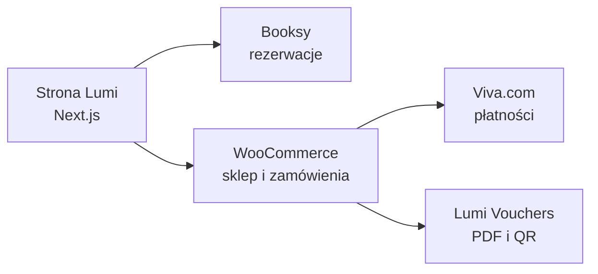

# Lumi Bali Spa

Tworzymy cyfrowe doświadczenie marki Lumi Bali Spa — od pierwszego kontaktu ze
stroną, przez rezerwację masażu, aż po zakup kosmetyków i voucherów.

Lumi Bali Spa łączy balijskie rytuały, spokojny design i nowoczesną obsługę
klienta. Obecnie rozwijamy serwis dla salonów w **Radzyminie** i **Grójcu** z
architekturą gotową na kolejne lokalizacje.

## Ekosystem

- indywidualna, responsywna strona Lumi Bali Spa;
- oferta masaży, rytuałów, salonów i rezerwacji Booksy;
- sklep z kosmetykami używanymi w salonach;
- elektroniczne i drukowane vouchery z bezpiecznym kodem QR;
- zaplecze WooCommerce przygotowane do obsługi kolejnych lokalizacji.

## Projekt

Główny kod aplikacji znajduje się w prywatnym repozytorium
`lumi-bali-spa-web`. Dokumentacja techniczna, procedury wdrożenia i konfiguracja
lokalnego środowiska są utrzymywane razem z kodem.

Strona: [lumibalispa.pl](https://lumibalispa.pl)

---

Projekt rozwijany dla Lumi Bali Spa. Dostęp do kodu i infrastruktury jest
ograniczony do upoważnionych członków zespołu.
